# Pokémon Recompiled (PokeRecomp)

Native PC versions of **Pokémon FireRed, LeafGreen and Emerald**, built from the
[pret](https://github.com/pret) decompilations with our own PC layer. There's no emulator:
each game is a native Windows DLL. It runs off **your own cartridge**: the first time you
pick a game, you import your ROM and its content is unpacked into that game's `.pkmn` file.

Every game is online. Trainers meet, battle, trade and chat on shared worlds. A Kanto
trainer can travel to Hoenn's worlds as themselves, with their party, and the other
way round.

> Unofficial fan project, not affiliated with Nintendo, Creatures Inc., GAME FREAK inc. or
> The Pokémon Company. No ROMs or game downloads are included.

## Download

Get the latest **PokeRecomp-…-windows.zip** from [Releases](https://github.com/sonsegajp/PokeRecomp/releases),
extract it and run **`Launch PokeRecomp.cmd`**.

Needs Windows 10/11, the Microsoft Edge WebView2 Runtime, .NET Framework 4.7.2 and
Python 3.10+ (the launcher's local service).

ROMs: FireRed (USA 1.0 / 1.1), LeafGreen (USA 1.0 / 1.1), Emerald (USA/Europe).
Ruby and Sapphire are shown in the launcher but aren't available yet.

## The launcher

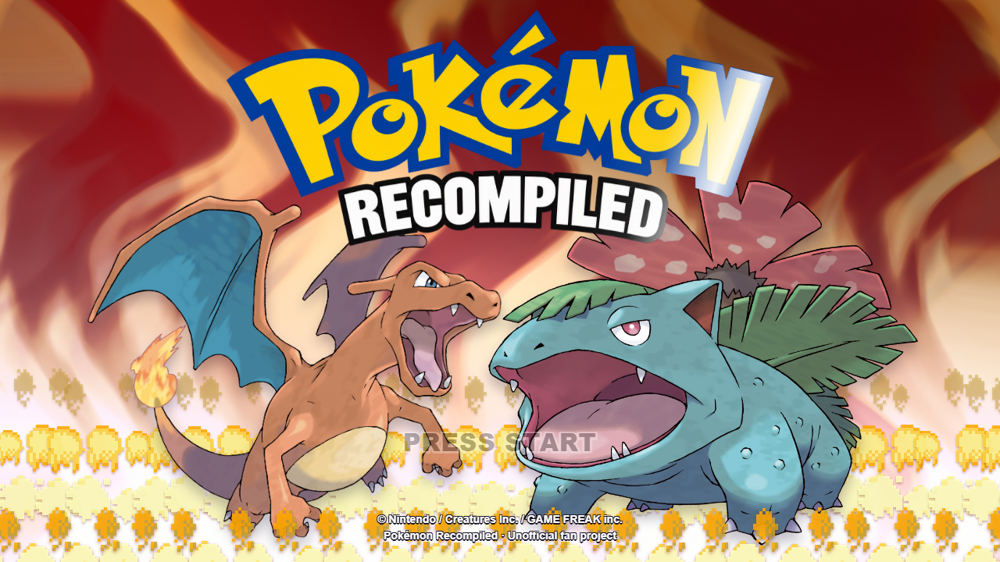

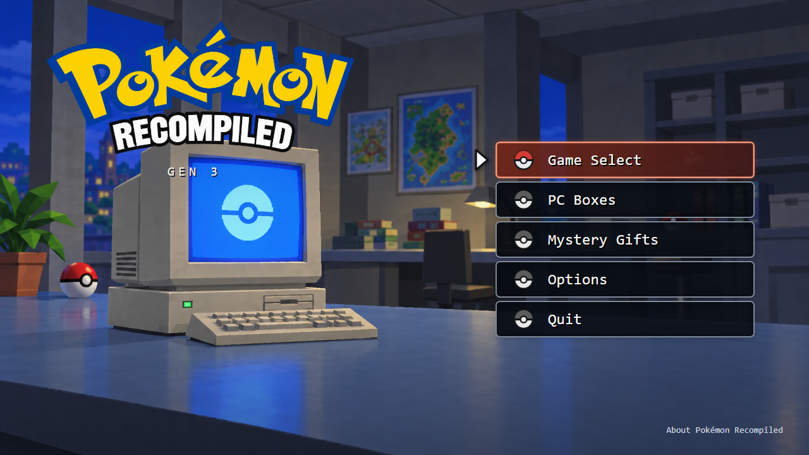

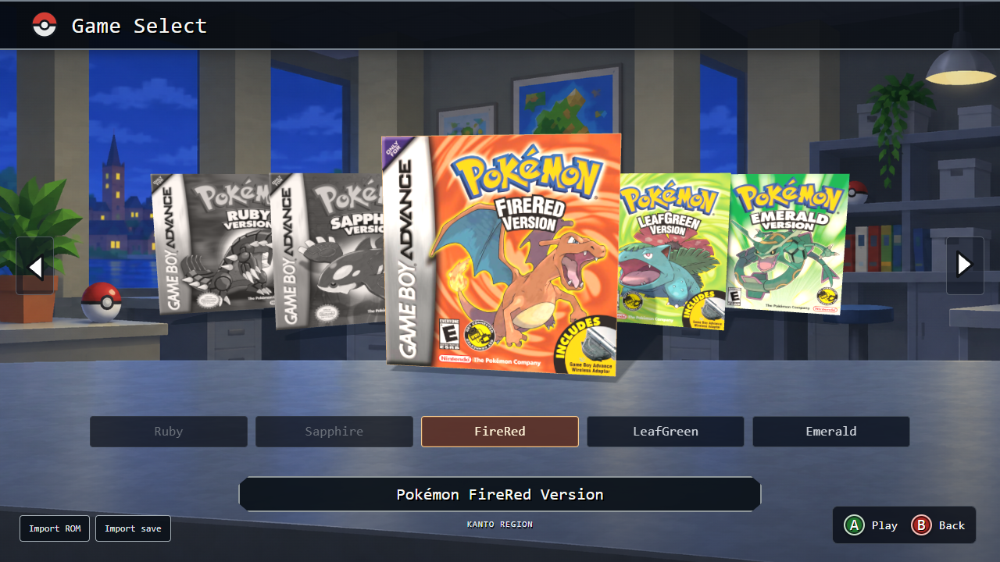

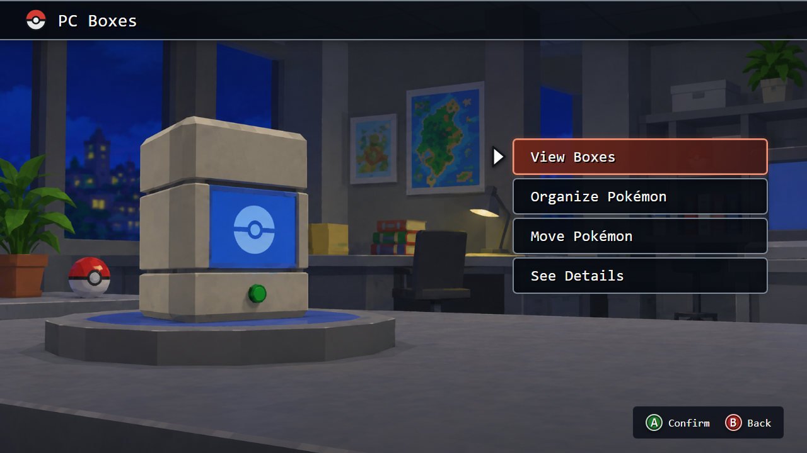

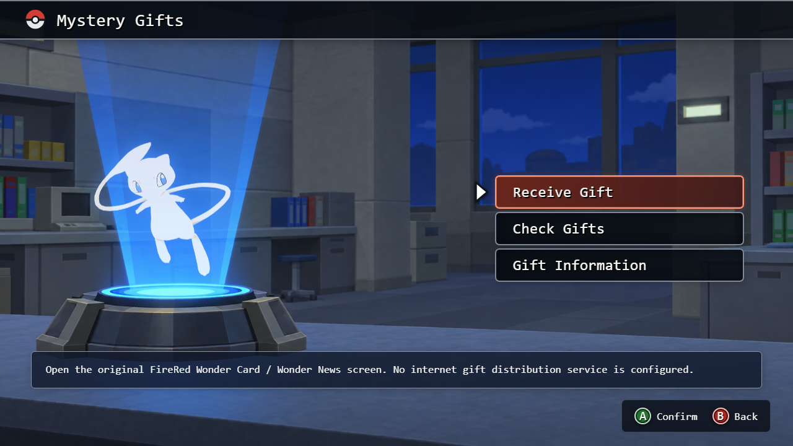

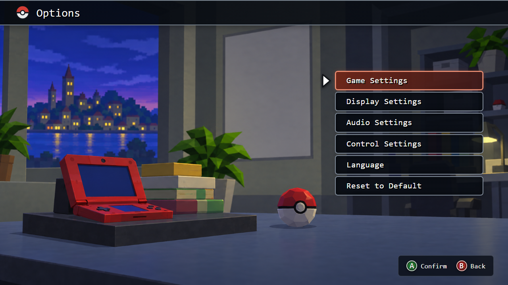

## Controls

Keyboard and controllers (any number, plugged in any time) both work. Remap every button
in the launcher (**Options → Control Settings**) or in game (**F1**, or hold **Back + Start**).

| | Keyboard | Controller |
|---|---|---|
| A / B | X / Z | A / B |
| Start / Select | Enter / Backspace | Start / Back |
| L / R | A / S | LB / RB |
| Move | Arrow keys | D-pad / left stick |
| Fast-forward (offline) | hold Tab | hold RT |

**T** opens chat on a world, **F11** toggles fullscreen and **F2** cycles the pixel filter.

## Online

Go to the desk on the left of any Pokémon Center 2F, the **ONLINE CLUB**. The first time
you come upstairs, the professor's aide shows you around every desk.

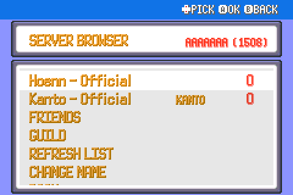

- **Worlds:** official Kanto and Hoenn worlds, plus anyone's community worlds.
- **Name tags:** every trainer's name floats over their head.
- **Chat:** press **T**.
- **Battles and trades:** talk to another trainer for a real link battle or trade. Hacked
  Pokémon are turned away.
- **Global trade:** Wonder Trade, the GTS and a mailbox, at the middle desk.
- **POKéMON MARKET:** buy and sell items with other trainers, at the right desk.
- **Social:** friends and guilds, with guild chat across worlds.
- **World events:** a daily shiny-boosted type, and timed mass outbreaks on the routes.
- **Shiny news:** everyone on the world hears when someone finds or catches a shiny.
- **Positions:** a world remembers where you were when you left. Your offline game keeps
  its own spot: leaving a world (or saving while on one) puts you back where you were
  playing offline.

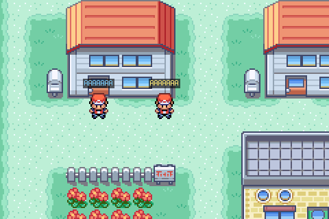

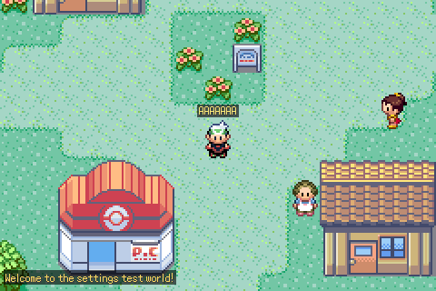

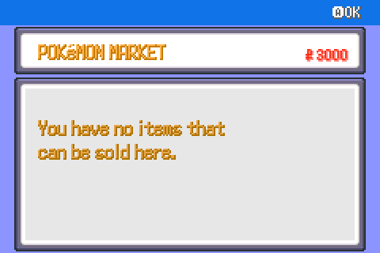

### Travel between regions

Pick the other region's world in the ONLINE CLUB and you go there as yourself: same
trainer, same party, with your own region's sprites, battle back pic and trainer card.

- **First visit:** starts that region's story in its first town.
- **Your party:** comes along and returns home with you.

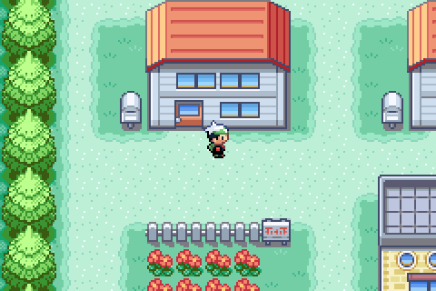

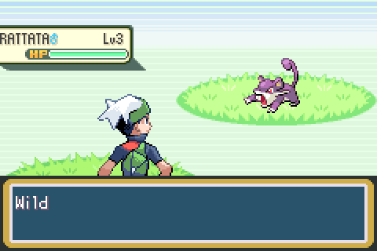

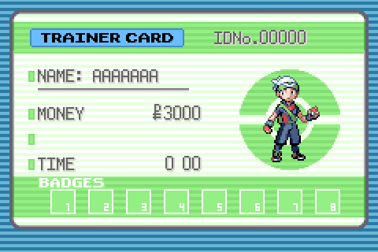

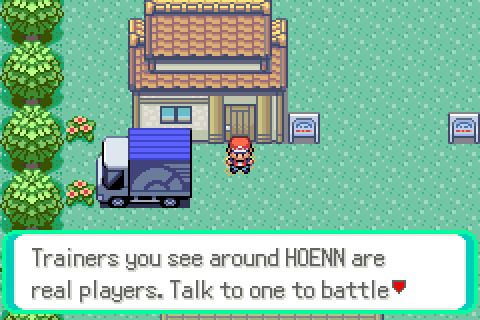

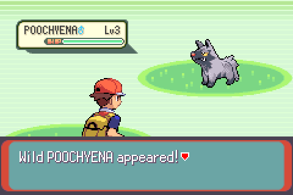

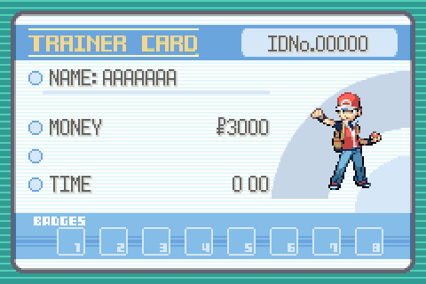

## Host your own world

Anyone can host a world, and it shows up in every player's server browser. Run the
`.bat` for your region and game:

- `Host Kanto World (FireRed).bat`
- `Host Kanto World (LeafGreen).bat`
- `Host Hoenn World (Emerald).bat`

It reads the rules from your own game and makes a settings file you can edit:

| setting | |
|---|---|
| `name`, `port`, `max_players`, `welcome` | the world's name, port, size and arrival message |
| `shiny_odds`, `boost_shiny_odds`, `boost_type` | shiny odds for every wild Pokémon and for the boosted type (`daily`, `off`, or e.g. `FIRE`) |
| `outbreaks`, `outbreak_every`, `outbreak_length`, `outbreak_share` | mass outbreaks |
| `legality_checks`, `battles`, `trades` | the world's rules |

Hosting needs Python 3, and the port has to be forwarded on your router. Players' logins
never reach your PC: each join uses a one-time ticket for your world only.

## Building

- **Toolchains:** MSYS2 with mingw32 (i686) gcc, plus devkitARM for the pret asset builds.
- **pret assets:** `make modern` in `game/` (FireRed/LeafGreen) and `emerald/`.
- **Games:** `./build.sh VERSION=FIRERED|LEAFGREEN|EMERALD -j8`. This produces
  `games/<id>.dll` and `PokeRecompGame.exe`.
- **ROM content:** with the retail ROMs next to the repo, the build takes the
  cartridge content out of each DLL (`tools/rompack.c`).
- **Release zip:** `python tools/make_release.py VERSION`.

See [docs/GAME_DLL.md](docs/GAME_DLL.md), [docs/LAUNCHER.md](docs/LAUNCHER.md) and
[server/deploy/README.md](server/deploy/README.md).

## Credits

- [pret](https://github.com/pret): the pokefirered and pokeemerald decompilations.
- SDL2, three.js, Microsoft WebView2.
